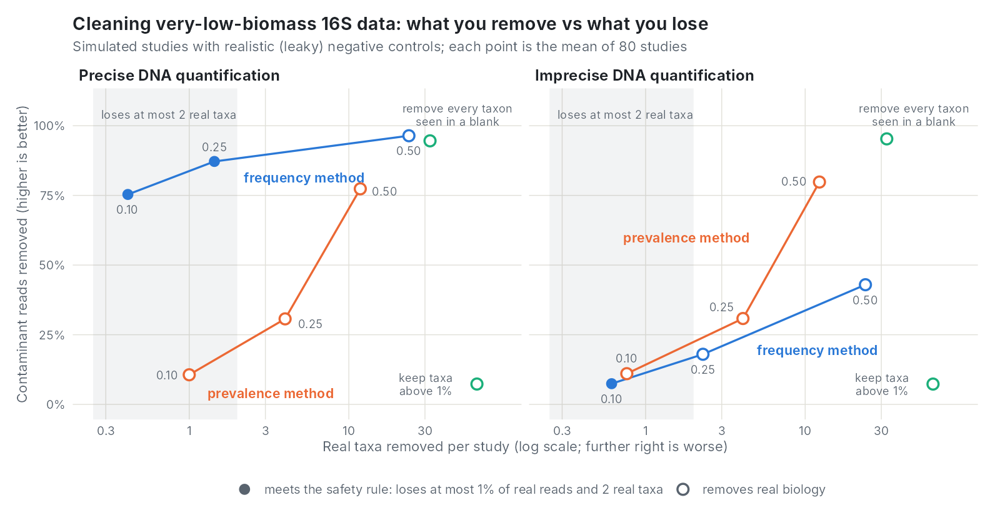

# Contaminant removal in low-biomass 16S data

[](https://github.com/joangordo/decontam-low-biomass/actions/workflows/tests.yaml)

**How well do common contaminant-removal methods work when we know the right
answer?** This project evaluates the R package
[decontam](https://benjjneb.github.io/decontam/) and several simple filters in
two settings where every read can be labelled as genuine or contaminant: a
public mock-community dilution series and a simulation study. It ends with a
practical guide and a reusable cleaning workflow.

**[Read the reports →](https://joangordo.github.io/decontam-low-biomass/)**

<a href="https://joangordo.github.io/decontam-low-biomass/analysis/02_simulation_study.html">
  <picture>
    <source media="(prefers-color-scheme: dark)" srcset="figures/readme-tradeoff-dark.png">
    
  </picture>
</a>

*With precise DNA quantification, decontam's frequency method at a threshold of 0.1–0.25 removes
most of the contamination and almost no real biology. With imprecise quantification no safe option
removes more than a fifth: the bottleneck is in the lab, not in the software.*

| Part | Question |
|---|---|
| [1. Benchmark](https://joangordo.github.io/decontam-low-biomass/analysis/01_mock_dilution_benchmark.html) | How do decontam and simple filters perform on a real mock-community dilution series with known composition? |
| [2. Simulation study](https://joangordo.github.io/decontam-low-biomass/analysis/02_simulation_study.html) | How do the number of negative controls, DNA quantification and cross-contamination change the answer? (48 scenarios × 20 studies) |
| [3. Decision guide](https://joangordo.github.io/decontam-low-biomass/analysis/03_decision_guide.html) | Which method and threshold to use, an end-to-end workflow per sample type, and auto-generated methods text |

## Key findings

**On real data (mock-community dilution series)** · [Part 1 report →](https://joangordo.github.io/decontam-low-biomass/analysis/01_mock_dilution_benchmark.html)

- Removing every taxon seen in the negative control deleted 3 of the 9
  genuine taxa and up to 34% of the true reads in a sample.
- decontam's frequency method removed 14% of contaminant reads in the most
  diluted samples at the default threshold (0.1) and 71% at 0.5.
- Among the ASVs it can score, the frequency method separates contaminants
  from genuine taxa almost perfectly (AUC 0.99), but 675 of 946 ASVs appear
  in a single sample and cannot be scored.

**In simulation (realistic, slightly leaky negative controls)** · [Part 2 report →](https://joangordo.github.io/decontam-low-biomass/analysis/02_simulation_study.html)

- **DNA quantification matters more than the method.** In very-low-biomass
  studies the frequency method (threshold 0.1) removed 75% of the
  contamination with precise quantification and 7% with imprecise
  quantification.
- **High thresholds remove real biology.** With realistic communities, a
  threshold of 0.5 removed about 25 rare genuine taxa per study, something
  the mock community could not show.
- **Prevalence-based methods are vulnerable to cross-contamination.** With 8
  leaky controls, the prevalence method at threshold 0.25 removed 32% of
  genuine reads (28% with imprecise quantification); more controls made it
  worse, not better.

**Recommendation:** decontam's frequency method with a threshold of 0.1–0.25,
applied per sample type and reported explicitly. It was the best safe choice
in 18 of the 24 simulated designs with realistic controls; a threshold of 0.5
never met the "don't remove real biology" rule. When biomass is very low and
quantification imprecise, no method removed more than about a fifth of the
contamination: that has to be fixed in the lab, not in software.
[Part 3: decision guide and worked example →](https://joangordo.github.io/decontam-low-biomass/analysis/03_decision_guide.html)

The simulation follows decontam's own model of contamination (the same amount
of contaminant DNA in every tube), so it is a best case for the frequency
method. Contamination that grows with sample handling would weaken it;
[Part 2](https://joangordo.github.io/decontam-low-biomass/analysis/02_simulation_study.html#limitations-of-the-simulation) lists this and the other limitations.

## Background

In low-biomass samples (biopsies, swabs, blood, ascitic fluid) the DNA that
comes from reagents and the lab environment can rival or exceed the DNA from
the sample itself. Typical cleaning workflows combine read-depth cut-offs,
abundance pre-filters and decontam at a fixed threshold, but they are rarely
evaluated, because on real samples there is no ground truth. This repository
builds such a workflow from scratch and evaluates it on open data where the
truth is known.

This is an independent project, not affiliated with or endorsed by any
institution. The question comes from my own experience analysing low-biomass
16S data, but no data, code or documents from any previous work are used
here: everything is built on public data and the published literature.

### Design choices

| Choice | Why |
|---|---|
| Sample IDs matched and validated (`load_dataset()`) | If metadata and counts are silently out of order, every result is wrong |
| Abundance pre-filter computed over true samples only | Computed over controls too, it keeps taxa that are abundant only in the blanks |
| Controls used without removing everything seen in them (`flag_control_dominant()`) | Removing every taxon found in a blank deletes real taxa (Part 1) |
| Read-depth rules as functions (`flag_low_read_samples()`) | The same rule is applied every time and recorded |
| Threshold treated as a parameter and swept | The default (0.1) is a choice, and its effect is large |
| Each sample type cleaned against its own controls | Contamination is a larger share of blood than of a swab |
| Scored against a known truth, on real and simulated data | On real samples there is no way to check a cleaning method |
| `clean_low_biomass()` returns every decision; `methods_text()` drafts the methods paragraph from it | Cleaning should be reported, not just applied |

## Repository structure

```
├── R/
│   ├── io.R                 # loading and validation
│   ├── preprocess.R         # simple filters and read-depth rules
│   ├── decontam_methods.R   # decontam wrapper
│   ├── evaluate.R           # metrics against the ground truth
│   ├── simulate.R           # simulation model and per-study scoring
│   └── workflow.R           # clean_low_biomass() and methods_text()
├── analysis/
│   ├── 01_mock_dilution_benchmark.qmd
│   ├── 02_simulation_study.qmd
│   ├── 03_decision_guide.qmd
│   ├── run_simulation.R     # regenerates results/simulation_results.rds
│   ├── readme_figure.R      # the summary figure above (figures/)
│   └── results/
├── data/                    # processed CSVs + data README (source and licence)
├── data-raw/                # builds data/ from the original files
├── docs/                    # rendered site (GitHub Pages)
├── tests/testthat/          # unit tests (hand-checkable examples + real data)
└── .github/workflows/       # runs the tests on every push
```

## Reproduce

Requires R (≥ 4.3) and [Quarto](https://quarto.org/). Open the project in R
from its root folder (renv activates itself), then:

```r
renv::restore()                          # exact package versions from renv.lock
testthat::test_dir("tests/testthat")     # run the tests
```

Without renv, `source("install.R")` installs the latest versions instead.

```bash
Rscript analysis/run_simulation.R        # optional: ~7 min, results are cached
quarto render                            # writes the site to docs/
Rscript analysis/readme_figure.R         # the summary figure in this README
```

The processed data and simulation results are included, so the reports
render without re-running anything. The simulation is fully seeded and
resumable. The cached results were produced with R 4.6.1 and decontam 1.32.0,
as pinned in `renv.lock`. Under another R version a few simulated studies
come out differently (50 of 960 under R 4.3), which moves the headline
figures by up to three percentage points and changes none of the
conclusions.

## Using the workflow

This runs as is on the data in the repository:

```r
for (f in list.files("R", full.names = TRUE)) source(f)

d <- load_dataset("data")              # the mock-community data in this repository
d$samples$sample_type <- "mock"        # one sample type here; real studies have several

res <- clean_low_biomass(
  d$counts, d$samples,
  group = "sample_type",               # each type is cleaned against its own controls
  method = "frequency", threshold = 0.1
)
res$summary                            # what was done, per sample type
res$counts                             # cleaned counts (true samples only)
cat(methods_text(res))                 # draft methods paragraph
```

The last line prints:

> Contaminant sequences were identified separately for each sample type with decontam 1.32.0
> (Davis et al., 2018), using DNA concentration measured before library preparation. Mock
> samples (n = 9; 1 negative control) were cleaned with the decontam frequency method
> (threshold 0.10) after excluding 0 samples under the fixed (cut-off 1000) read-depth rule;
> 34 of 271 scored taxa were classified as contaminants, removing a median of 2.3% of reads
> per sample.

With your own data, `samples` needs `sample_id`, `is_neg`, `dna_conc` and a sample-type
column, with each negative control assigned to the type it belongs to. Each type can have
its own read-depth rule, for example `low_read_rule = c(blood = "neg_median")`.
[Part 3](https://joangordo.github.io/decontam-low-biomass/analysis/03_decision_guide.html) runs the workflow on a simulated study with two
sample types.

## Scope

This benchmark covers decontam and simple filters, the tools most often used
in practice. Newer methods that model where contamination comes from and how
it leaks between wells, such as SCRuB (Austin et al., 2023), are not
evaluated here; adding them is a natural next step. For the laboratory side
(controls, quantification and reporting), see the consensus guidelines of
Fierer et al. (2025).

## Data and references

Data from Karstens L. et al. (2019), *mSystems* 4(4): e00290-19,
[doi:10.1128/mSystems.00290-19](https://doi.org/10.1128/mSystems.00290-19)
(open-access article, CC BY 4.0). See [`data/README.md`](data/README.md) for the
source files and their terms.

decontam: Davis N.M. et al. (2018), *Microbiome* 6: 226,
[doi:10.1186/s40168-018-0605-2](https://doi.org/10.1186/s40168-018-0605-2).

SCRuB: Austin G.I. et al. (2023), *Nature Biotechnology* 41: 1820–1828,
[doi:10.1038/s41587-023-01696-w](https://doi.org/10.1038/s41587-023-01696-w).

Guidelines: Fierer N. et al. (2025), *Nature Microbiology* 10: 1570–1580,
[doi:10.1038/s41564-025-02035-2](https://doi.org/10.1038/s41564-025-02035-2).

Code released under the MIT licence.
